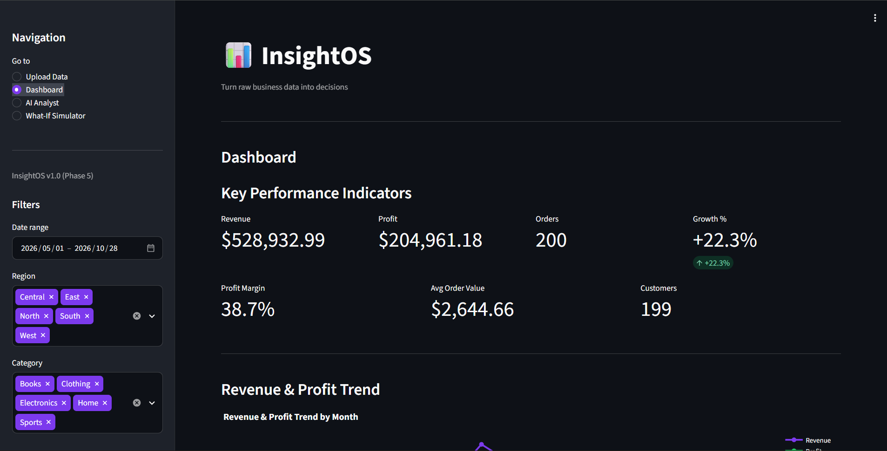
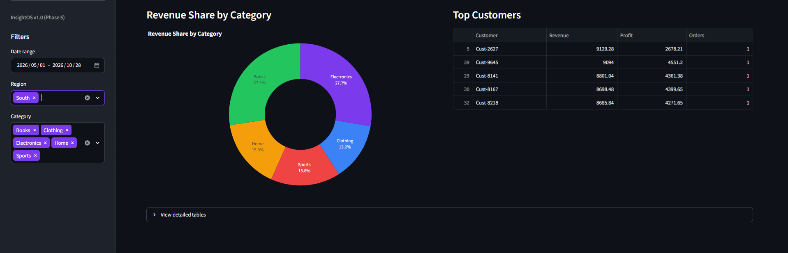
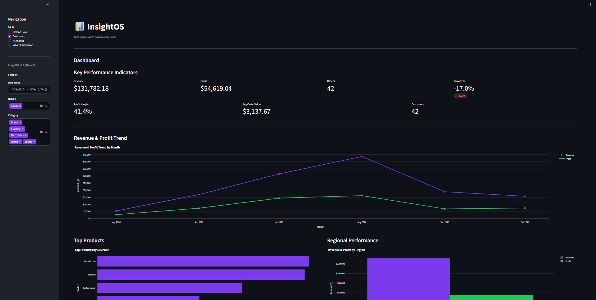
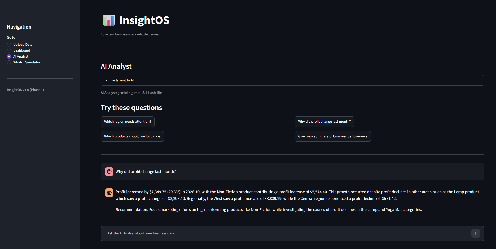
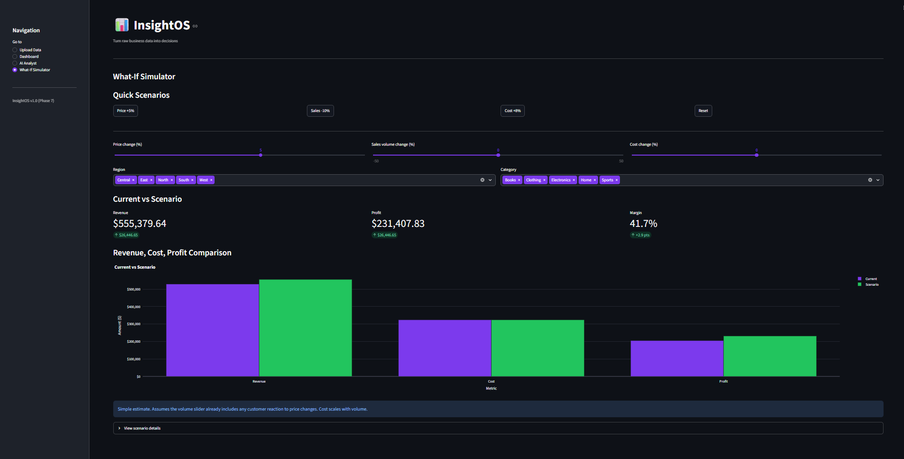

# InsightOS

Turn raw business data into decisions.

InsightOS is a Streamlit-based AI Business Intelligence platform built for
a Business Analytics student portfolio. It lets business users upload raw
sales data, explore KPIs through an interactive dashboard, ask questions
in natural language via an AI Analyst, and run what-if simulations. All
numbers are computed with pandas; the AI only explains a precomputed fact
sheet.

**Live demo:** https://insightos-bi.streamlit.app/ (AI Analyst is disabled in the public demo; run locally with your own API key to try it.)

## Screenshots

Dashboard overview:



Dashboard with filters applied:





AI Analyst:



What-If Simulator:



## Features

- **Upload Data** — Upload CSV or Excel files. Required columns are
  validated before processing; a bundled `data/sample_sales.csv` is
  included for instant testing.
- **Automatic data cleaning** — Cleans the uploaded data (title-casing,
  date parsing, duplicate removal, missing value handling, negative
  value filtering) and produces a cleaning report with counts of rows
  removed or filled (duplicates, invalid dates, invalid numbers,
  negative values, missing values).
- **KPI engine** — Revenue, profit, profit margin, orders, average order
  value, unique customers, month-over-month growth, monthly trends, top
  and bottom products, regional and category performance, top customers,
  and driver analysis.
- **Interactive dashboard** — KPI cards, charts, and tables with date
  range, region, and category filters.
- **AI Analyst** — Ask natural-language questions about your business
  data. The AI answers only from a pandas-computed fact sheet and is
  instructed not to calculate or rank numbers; rankings are precomputed
  in pandas. The "Facts sent to AI" expander lets you verify any answer.
- **What-If Simulator** — Model price, volume, and cost changes with
  sliders and see the impact on revenue, cost, profit, and margin.
  Includes quick scenario buttons and region/category filters.

## Design principle: number come from pandas, not the AI

All numbers in InsightOS are computed with pandas in `core/kpi.py`. The
AI Analyst (`core/ai_analyst.py`) does not calculate numbers. Instead,
`build_context()` produces a compact text summary of precomputed facts
(KPIs, growth, trends, rankings, driver analysis). The AI receives this
fact sheet and answers questions using only those facts.

Rankings (highest/lowest revenue, profit, margin by region, product,
and category) are computed in pandas and included in the fact sheet,
because the AI previously made ranking mistakes.

The "Facts sent to AI" expander on the AI Analyst page shows the exact
context text sent to the model, so you can verify any answer.

## Tech stack

- Python 3
- pandas — data cleaning and all calculations
- Plotly — interactive charts
- Streamlit — web UI
- openai package — OpenAI-compatible client for OpenRouter and Gemini
- python-dotenv — environment variable loading
- pytest — testing

## Project structure

```
insightos/
├── app.py                      # Streamlit entry point; page routing and UI
├── README.md                   # This file
├── requirements.txt            # Python dependencies
├── .env.example                # Example environment variables (copy to .env)
├── .streamlit/
│   └── config.toml             # Streamlit dark theme configuration
├── core/
│   ├── __init__.py
│   ├── loader.py               # CSV/Excel loading and column validation
│   ├── cleaner.py              # Data cleaning and cleaning report
│   ├── kpi.py                  # KPI engine + what-if simulation
│   └── ai_analyst.py           # AI Analyst context builder + OpenAI client
├── ui/
│   ├── __init__.py
│   ├── layout.py               # Sidebar navigation
│   └── charts.py               # Plotly chart builders
├── data/
│   └── sample_sales.csv        # Bundled sample dataset (200 rows)
├── assets/
│   └── screenshots/
│       ├── dashboard-overview.png
│       ├── dashboard-filtered.png
│       ├── dashboard-filtered-2.png
│       ├── ai-analyst.png
│       └── whatif-simulator.png
└── tests/
    └── test_kpi.py             # Pytest test suite
```

## Getting started

### Windows

```powershell
git clone https://github.com/romanalirandhawa-a11y/insightos.git
cd insightos
python -m venv venv
.\venv\Scripts\Activate.ps1
pip install -r requirements.txt
copy .env.example .env
streamlit run app.py
```

### macOS / Linux

```bash
git clone https://github.com/romanalirandhawa-a11y/insightos.git
cd insightos
python3 -m venv venv
source venv/bin/activate
pip install -r requirements.txt
cp .env.example .env
streamlit run app.py
```

The AI Analyst requires an API key in `.env` (`OPENROUTER_API_KEY` or
`GEMINI_API_KEY`, plus `AI_PROVIDER`). The rest of the app (upload,
cleaning, dashboard, what-if) works without any API key. Never commit
`.env` — copy `.env.example` instead.

## Required data columns

| Column | Description |
|--------|-------------|
| Date | Transaction date |
| Product | Product name |
| Category | Product category |
| Region | Sales region |
| Sales | Revenue amount |
| Cost | Cost amount |
| Quantity | Units sold |
| Customer | Customer identifier |

The bundled `data/sample_sales.csv` contains 200 realistic rows with all
required columns.

## Running tests

50 automated tests. Run with:

```bash
pytest tests/test_kpi.py
```

## Lessons learned / quality notes

- A bug in `driver_analysis` computed region changes from only product-region
  combinations present in both months, dropping new products. Hand-checking
  the AI's number against the dashboard revealed South's profit change was
  reported as -204.04 instead of the correct +611.66. The fix computes
  product and region changes separately (missing months treated as 0), and a
  regression test (`test_driver_analysis_new_entity_would_have_been_dropped`)
  guards against a recurrence.
- A separate bug in `driver_analysis` sorted decline lists from smallest to
  largest decline instead of largest to smallest, so "Products with profit
  decline" showed minor declines while hiding major ones. The fix sorts
  declines most-negative-first, covered by
  `test_driver_decline_sorted_biggest_first`.
- Rankings (highest/lowest revenue, profit, margin) are now computed in
  pandas because the AI previously made a ranking mistake (it claimed Central
  had the lowest profit when East did). Rankings are precomputed in the RANKINGS
  section of the AI context; the model is instructed to copy them rather than
  rank numbers itself.

## Limitations

- Sample data is synthetic and not from a real business.
- The What-If Simulator is a simple estimate with stated assumptions
  (volume already includes customer reaction to price; cost scales with
  volume), not a forecast.
- AI answers on free models can be inconsistent or occasionally empty.
  AI answers can occasionally contain wording mistakes, so verify numbers
  against the dashboard.
  The "Facts sent to AI" expander lets you verify the numbers behind any
  answer.
- Single-user local app; no authentication or multi-user support.

## Roadmap

- SQL database backend for multi-user data persistence
- Forecasting models
- Deployment to Streamlit Community Cloud
- PDF report export

## Author

**Abdullah Randhawa**
Business Intelligence & Analytics student

LinkedIn: https://www.linkedin.com/in/abdullah-randhawa-6a6ba0412
